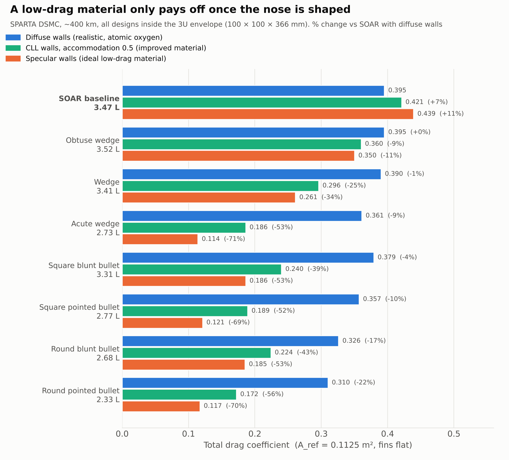

# DSMC Drag Study of a VLEO CubeSat

Rarefied-flow (DSMC) study of how nose geometry and surface properties
affect drag on a 3U CubeSat in very low Earth orbit, using SPARTA.

## Key results
- Workflow validated against free-molecular theory (within 0.3%) and Manchester's ADBSat tool (within 3%) using a reconstructed SOAR model
  
- Seven 3U-compatible nose designs compared against SOAR with realistic (diffuse) surfaces: shape alone cuts drag by up to 22%; shape plus an improved low-accommodation material (CLL, 0.5) by up to 56%; an ideal specular material by up to 71%
  
- An improved material on SOAR's flat-fronted shape increases drag by 7%: the material only helps once the nose is shaped
  
- Best trade-off: the square blunt bullet keeps 95% of the internal volume and cuts drag by 39% with an improved material

## Status
Case files, geometry and post-processing scripts being tidied for upload.
