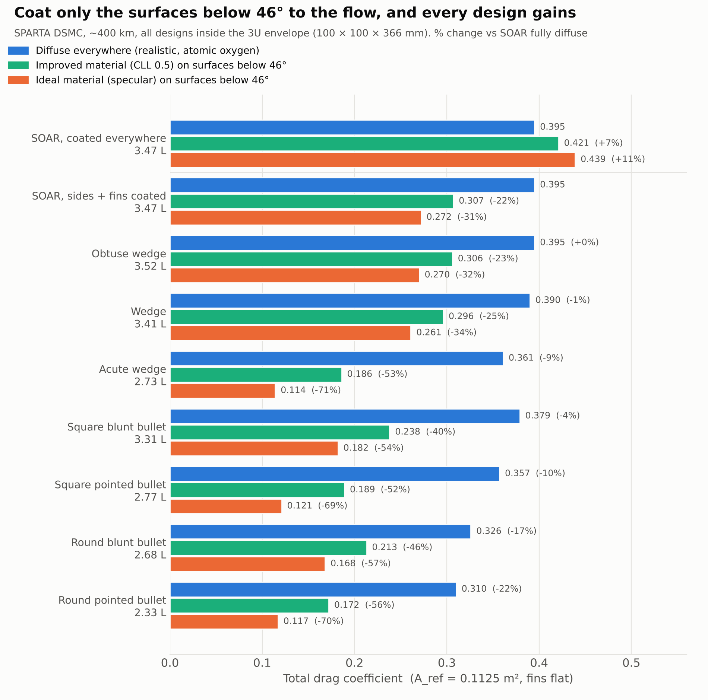
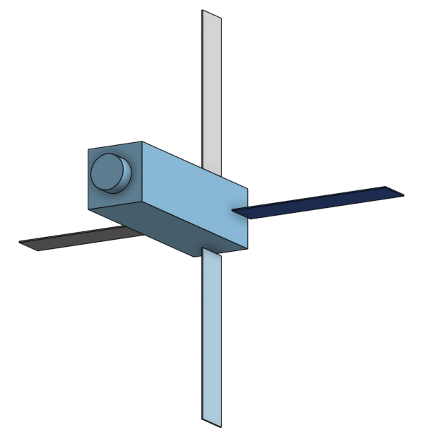
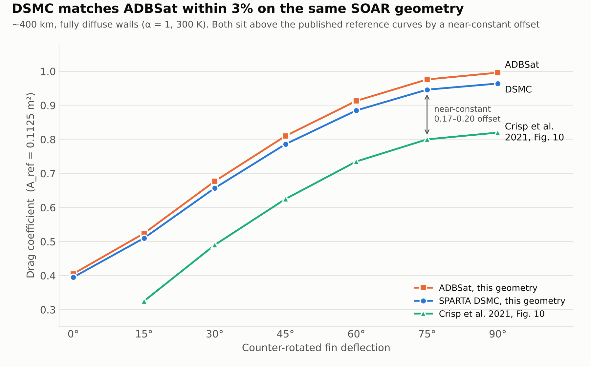

# DSMC Drag Study of a VLEO CubeSat

Rarefied-flow (DSMC) study of how nose geometry and surface materials affect drag on a 3U CubeSat in very low Earth orbit (~400 km), using [SPARTA](https://github.com/sparta/sparta). The method is validated against free-molecular theory and against the University of Manchester's ADBSat tool on a reconstructed model of the SOAR satellite. It is then used to compare seven nose designs that all fit the standard 3U launch envelope.

## Key results

- **Validated workflow:** within 0.3% of analytical free-molecular theory, and within 3% of Manchester's ADBSat panel-method tool on a reconstructed SOAR model.
- **Shape alone does little:** with realistic (diffuse) surfaces, the best nose shape cuts drag by 22%, and it gives up a third of the internal volume to do it.
- **A low-drag coating only reduces drag on surfaces angled less than ~46° to the flow:** coating every surface of SOAR raises drag by 7%, while coating only its sides and fins cuts it by 22%.
- **But drag is not the only job of a coating:** coatings also protect against atomic-oxygen erosion, and the surfaces facing the oncoming atmosphere are the ones most exposed. Leaving them uncoated trades lifetime for drag (see [Drag vs protection](#drag-vs-protection-trade-off)).
- **Shaping removes the trade-off:** on a well-shaped nose almost nothing is steeper than 46°, so the whole satellite can be coated for protection at little or no drag cost. The square blunt bullet keeps 95% of the internal volume and cuts drag by 39% fully coated with an improved material (CLL, accommodation 0.5), and by 40% with its steep cap left bare.
- **Upper bounds:** with the improved material, drag falls by up to 56%; an ideal specular material gives up to 71%.
- **Effects a panel method misses:** DSMC captures thermal shadowing of the fins by the body, and molecules reflected from the body onto the fins.



## The designs

Every body fits inside the 3U envelope (100 × 100 × 366 mm), with its rear face in the same place. The four fins, the flow conditions and the reference area are identical in every case, so only the body changes. Click a name to open the 3D model in GitHub's viewer.

| | | | |
|:---:|:---:|:---:|:---:|
|  |  |  |  |
| [**SOAR baseline**](geometry/SOAR.stl)<br>3.47 L · flat front + INMS | [**Obtuse wedge**](geometry/SOAR (Obtuse Wedge).stl)<br>3.52 L · ~120° apex | [**Wedge**](geometry/SOAR (Wedge).stl)<br>3.41 L · ~90° apex | [**Acute wedge**](geometry/wedge_acute.stl)<br>2.73 L · ~30° apex |
|  |  |  |  |
| [**Square blunt bullet**](geometry/square_blunt_bullet.stl)<br>3.31 L | [**Square pointed bullet**](geometry/square_pointed_bullet.stl)<br>2.77 L | [**Round blunt bullet**](geometry/round_blunt_bullet.stl)<br>2.68 L | [**Round pointed bullet**](geometry/round_pointed_bullet.stl)<br>2.33 L |

## Results

Total drag coefficient with the fins flat (A_ref = 0.1125 m²). The CLL and specular columns apply the material only to surfaces shallower than 46° to the flow; steeper surfaces stay diffuse. Percentages are against SOAR with diffuse walls.

| Design | Volume | Diffuse | CLL 0.5 | Specular |
|---|---|---|---|---|
| SOAR, coated everywhere (rule not applied) | 3.47 L | 0.395 | 0.421 (+7%) | 0.439 (+11%) |
| SOAR, sides + fins coated | 3.47 L | 0.395 | 0.307 (−22%) | 0.272 (−31%) |
| Obtuse wedge | 3.52 L | 0.395 (0%) | 0.306 (−23%) | 0.270 (−32%) |
| Wedge | 3.41 L | 0.390 (−1%) | 0.296 (−25%) | 0.261 (−34%) |
| Acute wedge | 2.73 L | 0.361 (−9%) | 0.186 (−53%) | 0.114 (−71%) |
| Square blunt bullet | 3.31 L | 0.379 (−4%) | 0.238 (−40%) | 0.182 (−54%) |
| Square pointed bullet | 2.77 L | 0.357 (−10%) | 0.189 (−52%) | 0.121 (−69%) |
| Round blunt bullet | 2.68 L | 0.326 (−17%) | 0.213 (−46%) | 0.168 (−57%) |
| Round pointed bullet | 2.33 L | 0.310 (−22%) | 0.172 (−56%) | 0.117 (−70%) |

Statistical noise is about ±0.002 in C_D.

## Drag vs protection trade-off

The 46° rule gives the lowest drag, but it leaves the steepest surfaces uncoated. Those ram-facing surfaces receive the highest atomic-oxygen flux, so a coating that also protects against erosion and oxidation is most valuable exactly where the rule says to leave it off. Leaving them bare saves drag but shortens surface life. Satellite lifetime and erosion are not modelled here, so the table below gives the drag side of the trade only.

Drag cost of coating every surface (fins flat), compared with leaving the steep surfaces bare and coating the rest:

| Design | Fully coated, CLL 0.5 | Steep surfaces bare, CLL 0.5 | Drag cost of full coating, CLL / specular |
|---|---|---|---|
| SOAR | 0.421 | 0.307 | +37% / +61% |
| Obtuse wedge | 0.360 | 0.306 | +18% / +30% |
| Round blunt bullet | 0.224 | 0.213 | +5% / +10% |
| Square blunt bullet | 0.240 | 0.238 | +1% / +2% |
| Wedge, acute wedge, pointed bullets | same | same | 0% (no surface steeper than 46°) |

On a flat-fronted satellite the trade-off is severe: full protection costs over a third more drag. On a shaped nose it largely disappears, because almost every surface already sits below the crossover angle. That makes shaping the nose the way to get both low drag and full coating protection.

A further option, not simulated here, is to use two coatings: a protective coating with diffuse behaviour on the steep surfaces, and a low-accommodation coating everywhere else.

## Method

| Item | Value |
|---|---|
| Solver | SPARTA DSMC, 10 MPI ranks on an Apple M4 Pro |
| Geometry | Onshape, exported as text STL in metres |
| Atmosphere | ~400 km, NRLMSIS 2.0 (Oct–Nov 2021, F10.7 = 85): 818 K, 7.67 km/s, n = 4.94 × 10¹³ m⁻³; 87.6% O, 7.5% He, 3.1% N₂, 1.9% N |
| Wall temperature | 300 K |
| Reference area | 0.1125 m² (half of SOAR's total surface area, as in Crisp et al. 2021) |
| Averaging | 3,000 fill steps, then forces averaged over 10,000 steps |

### Wall models

In free molecular flow, drag is set by what happens when a molecule hits the surface. The three conditions are:

- **Diffuse** (realistic): the molecule is re-emitted in a random direction at the wall temperature. Atomic oxygen adsorbs onto spacecraft surfaces and makes them behave this way.
- **CLL, accommodation 0.5** (improved material): the Cercignani–Lampis–Lord model, partway between diffuse and specular. In SPARTA it is `cll 300.0 0.5 0.5 1.0 1.0` (normal and tangential *energy* accommodation 0.5), which is σ_T = 0.293 in ADBSat's momentum convention. The value is illustrative, not measured.
- **Specular** (ideal): mirror reflection, a theoretical limit.

A reflective surface roughly doubles the drag on a face-on surface, but greatly reduces it at grazing angles. A Monte Carlo calculation of each wall model puts the crossover at about **46°** for these conditions. `scripts/tag_by_angle.py` uses this to keep each body triangle diffuse or coat it.

### SOAR reconstruction

The SOAR model is a reconstruction from published data (Crisp et al. 2021, Table 1). The fin dimensions were not published. They were inferred from the total surface area, a fit to the published drag curves and the published images: 285 × 60 × 2 mm, with an assumed 60 mm INMS.

## Validation

| Step | Comparison | Agreement |
|---|---|---|
| 1 | Sphere and flat plate (diffuse, specular, CLL) vs analytical free-molecular solutions | within 0.3% |
| 2 | Reconstructed SOAR, 0–90° fin sweep vs ADBSat on the same geometry | within 3% |



The 2–3% that DSMC sits below ADBSat grows with fin angle. This is consistent with two effects that a panel method leaves out: the body shadowing the fin roots from thermally drifting molecules, and molecules reflected off the fins onto the body.

Both DSMC and ADBSat sit a near-constant 0.17–0.20 above the reference curves in Crisp et al. (2021, Fig. 10), while matching how drag changes with fin angle. A constant offset points to a difference in the baseline geometry used for those curves rather than in the aerodynamic modelling. Resolving it needs that geometry.

## Limitations

- Results are for one altitude and solar condition. C_D varies by about 0.5% across the plausible solar range.
- CLL 0.5 is an illustrative "improved material". Real surfaces under atomic oxygen are typically closer to diffuse.
- The SOAR fin and INMS dimensions are estimates.
- The design comparison uses two fin angles (0° and 90°), not a full sweep.
- Coatings are modelled only through their gas–surface interaction. Erosion, oxidation, and any change in accommodation as a coating ages are not modelled, so the drag vs protection trade-off is described qualitatively.
- No flight data has been compared, because SOAR's flight drag results are not yet public.

## Repository structure

```
figures/        result figures and design renders
geometry/       STL files for every body and the four fins
cases/          SPARTA input files, wall-model files, species data
scripts/        make_figures.py       – regenerates the figures
                tag_by_angle.py       – splits a body into steep (diffuse) and shallow (coated) triangles
                soar_to_obj.py        – converts the SOAR parts to OBJ for ADBSat
                run_soar_adbsat.m     – ADBSat fin sweep in MATLAB
```

## Status

Case files, geometry and post-processing scripts are being tidied for upload.

## References

- Crisp, N. H. et al. (2021). *In-orbit aerodynamic coefficient measurements using SOAR (Satellite for Orbital Aerodynamics Research).* Acta Astronautica 180, 85–99.
- Crisp, N. H. et al. (2022). *Experimental Results from the SOAR Mission.* 73rd International Astronautical Congress (IAC-22).
- Sinpetru, L. A. et al. (2022). *ADBSat: Verification and validation of a novel panel method for quick aerodynamic analysis of satellites.* Computer Physics Communications 275. [ADBSat on GitHub](https://github.com/nhcrisp/ADBSat)
- Plimpton, S. J. et al. (2019). *Direct Simulation Monte Carlo on petaflop supercomputers and beyond.* Physics of Fluids 31, 086101. [SPARTA](https://sparta.github.io)

## Acknowledgements

Post-processing and analysis scripts were developed with AI assistance (Claude, Anthropic). Geometry, simulations and interpretation are my own.
